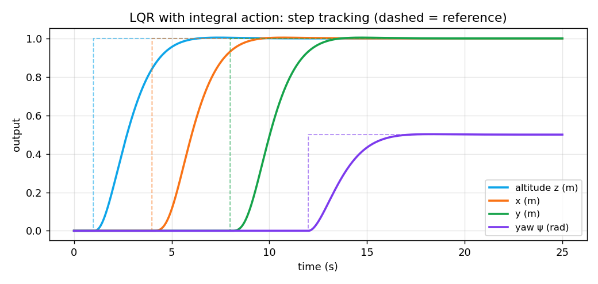

# Quadcopter LQR Control

State-space control of a quadcopter: modelling its nonlinear dynamics, linearizing them around hover, and designing controllers and observers so the drone **holds position and follows altitude, x/y and yaw commands**, even when it can't measure every state.



## What's inside
- **Modelling:** a 12-state nonlinear model (attitude, position and their rates) with 4 inputs (thrust plus roll, pitch and yaw torques), linearized at hover.
- **Analysis:** controllability, observability, Jordan form, transfer matrix, poles and zeros, and open-loop response.
- **State feedback:** pole placement, then **LQR with integral action** for offset-free tracking under constant disturbances. A static pre-compensator is included for comparison.
- **Observers:** full-order and reduced-order (Lyapunov-based) observers, so the controller can run on the 4 measured outputs only.
- **Simulink:** `main_simulation.slx` runs the controller on the nonlinear model.

## Results
With the LQR + integral design from `main.m` (Q = 10·I, R = I), each output follows its step command with **0.4% overshoot** and settles within **4.8 s**, with zero steady-state error.

## Run it
**MATLAB:** run `matlab/main.m` to load the parameters and gains, then open `matlab/main_simulation.slx`.

**Python** (no MATLAB needed; reproduces the plot above):
```bash
cd python
pip install -r requirements.txt
python lqr_tracking.py ../images/lqr_tracking.png
```

## Credits
Course project on modern control at Amirkabir University of Technology (winter 2024), supervised by Dr. Hajar Atrianfar.

**Team:** Sana Ranjbar, Vaniya Malekzahedi, Sheyda Niaparast and Tiba Tabshiri Namin.

**Tools:** MATLAB · Simulink · Control System Toolbox · Python
